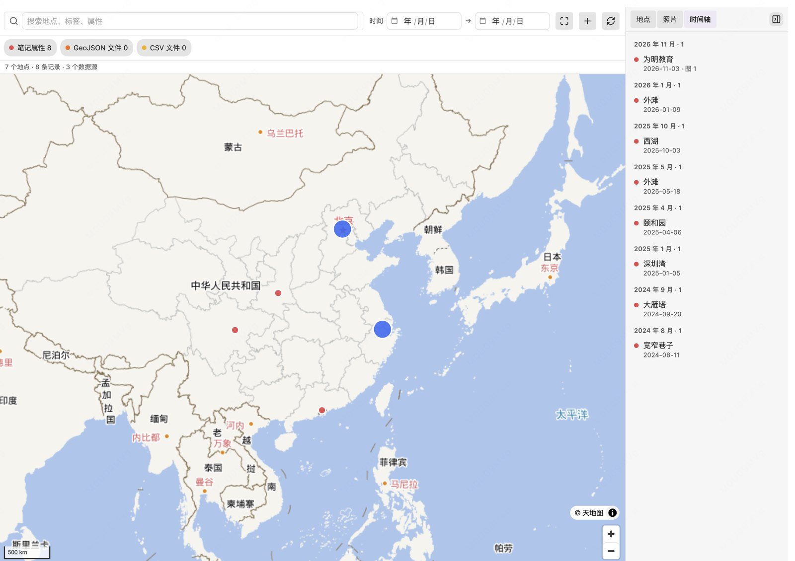
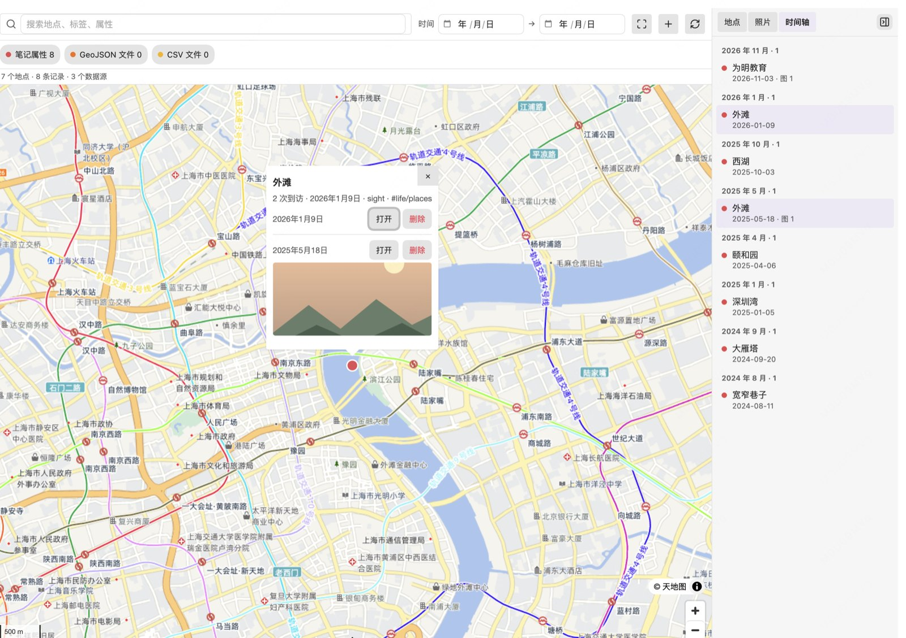
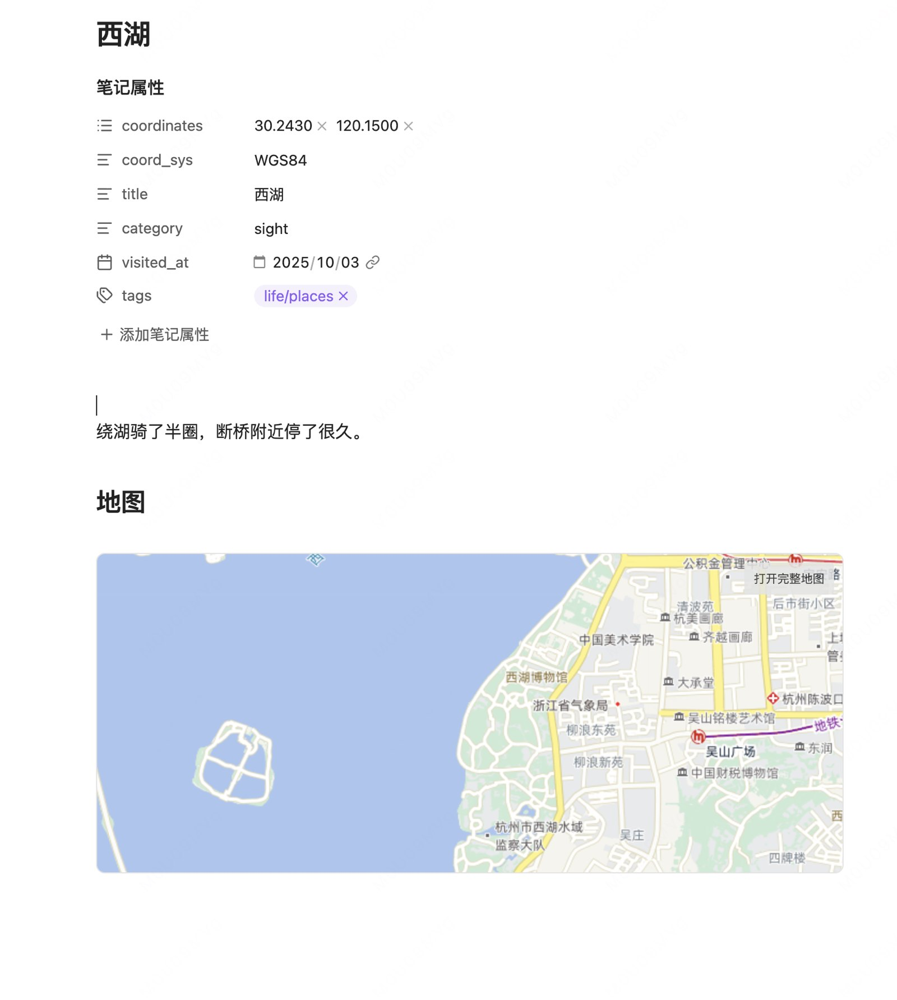

# Life Map

[简体中文](README.zh-CN.md) · English

> Repository: https://github.com/moyanmoyu/obsidian-life-map

A **general-purpose map view for Obsidian**: plot places from notes, GeoJSON, CSV or any JSON API on one map that works well in mainland China.

- **Note properties**: notes with coordinates show up automatically
- **GeoJSON / CSV**: drop the files into your vault
- **Any HTTP API**: declarative JSONPath mapping, no code
- **Place aggregation**: notes at the same spot merge into one marker, each visit is a sub-record
- **Layers**: stack multiple sources, toggle each one, colour-code by source
- **Search & filter**: free-text search plus date range
- **Clustering**: automatic when pins get dense
- **Photo wall & timeline** in the sidebar, plus a full-screen photo viewer
- **Inline maps**: render a small map inside a note with a `life-map` code block
- **Open from the map**: click a pin to jump back to its note
- **Export**: current filtered view to GeoJSON or a Markdown table

## Screenshots

Map view with clustering and the sidebar timeline:



One place, multiple visits (each visit is a sub-record you can open or delete):



Inline map inside a note:



## Installation

### Community directory

Not listed yet — use the manual method below for now.

### Manual

```bash
npm install
npm run build
npm run deploy -- /path/to/your/vault
```

Then in Obsidian: Settings → Community plugins → disable Safe mode → enable **Life Map**.

A map icon appears in the ribbon; you can also run `Life Map: Open map view` from the command palette.

## Creating a place note

### Option 1: command (recommended)

Run **`Life Map: New place note`** from the command palette, or click the **`+`** button in the map toolbar, then fill in:

| Field | Notes |
|---|---|
| Name | Note title and filename |
| Latitude / Longitude | Separate fields; negative for south/west |
| Coordinate system | `GCJ02` for AMap/Tencent, `WGS84` for GPS/GeoJSON |
| Category | Optional |

It creates and opens a note like this:

```markdown
---
coordinates: ["40.049600", "116.280700"]
coord_sys: GCJ02
title: "Some place"
category: "food"
tags:
  - life/places
---

## Map

```life-map
```
```

The target folder is configurable in **Settings → New note folder** (default `10-生活/地点`); duplicate names get `-2`, `-3`.

### Option 2: by hand

Create a note with frontmatter:

```yaml
---
coordinates: ["39.9042", "116.4074"]
coord_sys: WGS84
title: Some place
tags: [life/places]
---
```

Then add a `life-map` code block.

## Quick start

Add coordinates to any note:

```yaml
---
coordinates: ["39.9042", "116.4074"]
title: Example place
category: food
visited_at: 2025-03-02
tags: [life/places]
---
```

Open the map view and the pin appears.

## Inline maps

Add a `life-map` code block to any note to render a small map in place:

````markdown
```life-map
center: 40.0496, 116.2807
zoom: 14
height: 280
tag: life/places
interactive: false
```
````

| Option | Default | Description |
|---|---|---|
| `center` | the note's own coordinates | `[lat, lng]` or `"lat,lng"`, interpreted as **WGS-84**; falls back to a country-wide view |
| `zoom` | `13` with a center, else `4` | 1–18 |
| `height` | `260` | 120–600 px |
| `tag` | all | only show places carrying this tag |
| `limit` | `1000` | max number of markers |
| `interactive` | `true` | `false` renders a static map |

- When the note has coordinates, it is highlighted with an extra red marker
- Clicking a pin opens the corresponding note
- At most 6 inline maps per page (each one holds a WebGL context)
- "Open full map" carries the inline map's **viewport and tag filter** over; the filter chips can be removed individually

## Data sources

### 1. Note properties (enabled by default)

| Field | Default property | Notes |
|---|---|---|
| Coordinates | `coordinates` | `["lat","lng"]`, `"lat,lng"` or `{lat,lng}` |
| Fallback coords | `latitude` / `longitude` | used when the above is missing |
| Coordinate system | `coord_sys` | `WGS84` (default) / `GCJ02` / `BD09` |
| Name | `title` | falls back to the filename |
| Time | `visited_at` | used by the date filter |
| Category | `category` | |
| Tags | `tags` | merged with file tags |
| Cover / photos | `cover` / `photos` | wikilink, vault path or URL |

All property names are configurable.

### 2. GeoJSON

Drop `.geojson` files into the vault. Only `Point` / `MultiPoint` features are rendered for now.

### 3. CSV

Drop `.csv` files into the vault; a latitude and longitude column are required. Column names are auto-detected:

| Field | Recognised columns |
|---|---|
| Latitude | `lat` / `latitude` / `y` |
| Longitude | `lng` / `lon` / `long` / `longitude` / `x` |
| Name | `name` / `title` |
| Time | `time` / `date` / `visited_at` |
| Category | `category` / `type` |
| Tags | `tags` / `tag` |

CSV files without coordinate columns are skipped.

### 4. HTTP API (configured in settings)

Any JSON endpoint can be mapped declaratively:

```jsonc
{
  "name": "My places",
  "url": "https://api.example.com/v1/pois",
  "headers": { "Authorization": "Bearer xxx" },
  "coordSys": "gcj02",
  "mapping": {
    "list": "$.data.items",
    "id": "$.id",
    "name": "$.title",
    "lat": "$.location.lat",
    "lng": "$.location.lng",
    "time": "$.visited_at",
    "category": "$.type",
    "tags": "$.tags[*]",
    "photos": "$.photos[*].url",
    "link": "$.url"
  }
}
```

Supported JSONPath subset: `$.a.b`, `$.a[0].b`, `$.a[*].b` (leading `$.` optional).

Requests go through Obsidian's `requestUrl`, so **no CORS setup is needed** on your backend. GET only for now.

> ⚠️ Tokens in headers are stored in plain text in `.obsidian/plugins/life-map/data.json`.

## Basemaps

| Basemap | Key required | Notes |
|---|---|---|
| Tianditu (default) | `tk` | Compliant, stable in mainland China |
| OpenFreeMap | no | Fast overseas, may be slow in China |
| Custom XYZ | no | self-hosted or corporate tiles |
| AMap (preset) | no | one-click preset; **personal use only**, redistribution needs an AMap licence |

### Tianditu tk

1. Register at https://console.tianditu.gov.cn/ and create an app
2. Pick the "browser" key type and paste the `tk` into the settings
3. Tianditu gates requests on the **User-Agent**: plain `curl` gets `403 / 301012`, while Obsidian (Electron/Chromium) works. If your key is still rejected, switch it to the "server" type

Without a `tk` the plugin falls back to a keyless basemap and shows a hint — it never fails silently.

### Custom tiles

Point it at any `https://example.com/{z}/{x}/{y}.png` template. Mind the tile coordinate system: AMap/Tencent raster tiles are GCJ-02, Tianditu/self-hosted are usually WGS-84.

## Places outside China

Works fine: transparent coordinates skip the GCJ-02 offset, and OpenFreeMap (or any global tile source) covers the rest. Tianditu is China-focused, so switch to OpenFreeMap if your pins are abroad. The map auto-fits your data on first load, and the toolbar has a "Fit to all data" button.

## Extending (plugin authors)

Other plugins can register data sources and basemaps:

```ts
const lifeMap = (app as any).plugins.plugins['life-map'];
lifeMap?.api.registerSource({
  id: 'my-src',
  name: 'My data',
  async load() {
    return [{
      id: 'my-src:1',
      sourceId: 'my-src',
      name: 'Some place',
      lat: 39.9042,
      lng: 116.4074,
      coordSys: 'WGS84',
      tags: [],
      photos: [],
      props: {},
    }];
  },
});
```

API: `registerSource` / `unregisterSource` / `registerBasemap` / `refresh` / `getResults` / `getFeatures` / `open`.

There is intentionally **no user scripting hook** — that would be arbitrary code execution. Convert exotic data to GeoJSON/CSV, or write a small plugin.

## Deleting records

Each visit in the place popup has a delete button:

- Only vault Markdown notes can be deleted; they go to the trash (recoverable), not permanent deletion
- A confirmation dialog always appears first
- GeoJSON / CSV / HTTP sources are read-only and have no delete button
- The map, sidebar and counters refresh automatically afterwards

## Commands

| Command | What it does |
|---|---|
| `Life Map: Open map view` | open / focus the map |
| `Life Map: New place note` | form-driven note creation |
| `Life Map: Refresh map data` | reload every source |
| `Life Map: Export view as GeoJSON` | export the current filtered view (WGS-84) |
| `Life Map: Export view as Markdown table` | export the current filtered view |

## Compatibility

| Item | Notes |
|---|---|
| Minimum Obsidian | 1.5.0 |
| Desktop | macOS / Windows / Linux |
| Mobile | iOS / Android (basic support) |
| Offline | data sources work offline; basemaps need network or cached tiles |

## Network access and privacy

No telemetry, no auto-update mechanism. Network access only happens for:

| Purpose | Host |
|---|---|
| Tianditu tiles | `t0`–`t7.tianditu.gov.cn` |
| OpenFreeMap tiles | `tiles.openfreemap.org` |
| Custom tiles | whatever you configure |
| HTTP data sources | whatever you configure |

Credentials are stored locally in `.obsidian/plugins/life-map/data.json` (plain text). No note, photo or coordinate is ever collected or uploaded.

Two behaviours worth knowing about (shown in the community directory's automated review):

- **Vault enumeration** — to find `.geojson` / `.csv` files, the plugin lists vault file paths (`vault.getFiles()`). It only reads the contents of files whose extension matches an enabled data source; disable the GeoJSON / CSV sources in settings to skip this scan entirely.
- **Clipboard** — the "copy example" button in the empty state *writes* to the clipboard. The plugin never reads the clipboard.

## Known limitations (v0.9)

- Points only — no polylines (GPX tracks) or polygons
- Full reload on each refresh, no incremental sync
- Recommended up to ~20,000 places
- Photos are shown as thumbnails / lightbox, no album management

## Development and releasing

- [Development](docs/DEVELOPMENT.md): environment, commands, project layout, tests and pitfalls
- [Releasing](docs/RELEASING.md): version consistency, release flow, **how not to ship your map key**
- [Website](site/README.md): the static portal and Cloudflare Pages deployment

## License

MIT
